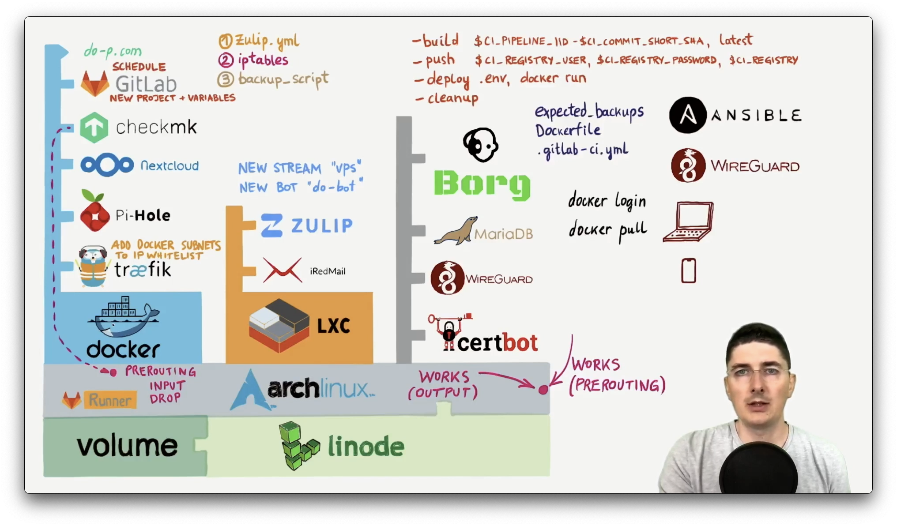
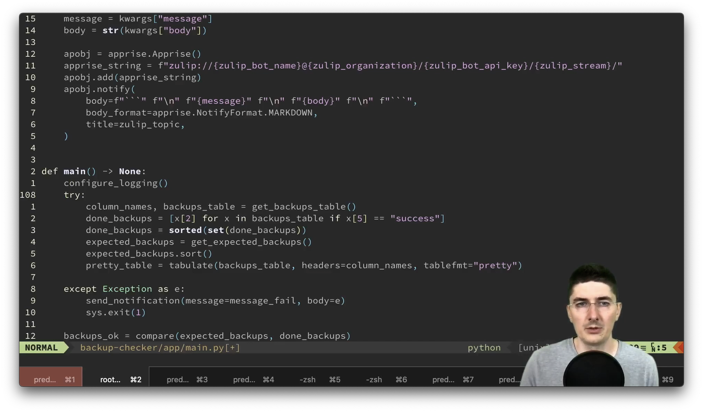

### Real world DevOps project from start to finish

 

These are the accompanying files for the DevOps course I've created.

Now on [YouTube](https://www.youtube.com/playlist?list=PL9VY98MP34xnGOXCH4aS5TNYAUxcYneWz)!

#### Errata

Each directory contains `errata.md` so be sure to check that out.

#### Slides

You'll need Go's [present](https://pkg.go.dev/golang.org/x/tools/present) package.

Install [Go](https://go.dev/).

Install `present` package:
`go install golang.org/x/tools/cmd/present@latest`

`cd` into the directory where you've cloned this repository and run `present`.

#### Contributing

I'll probably accept only spelling corrections, wrong file names or similar, or if something affects security. The idea is not to deviate from the material in the videos.

Happy learning!
